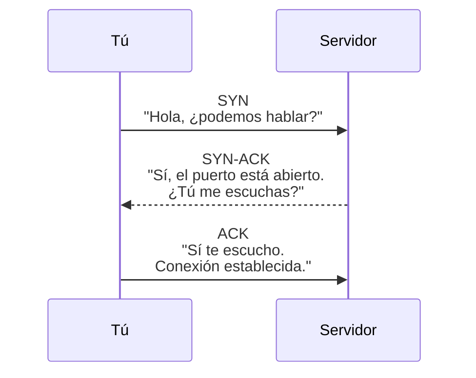
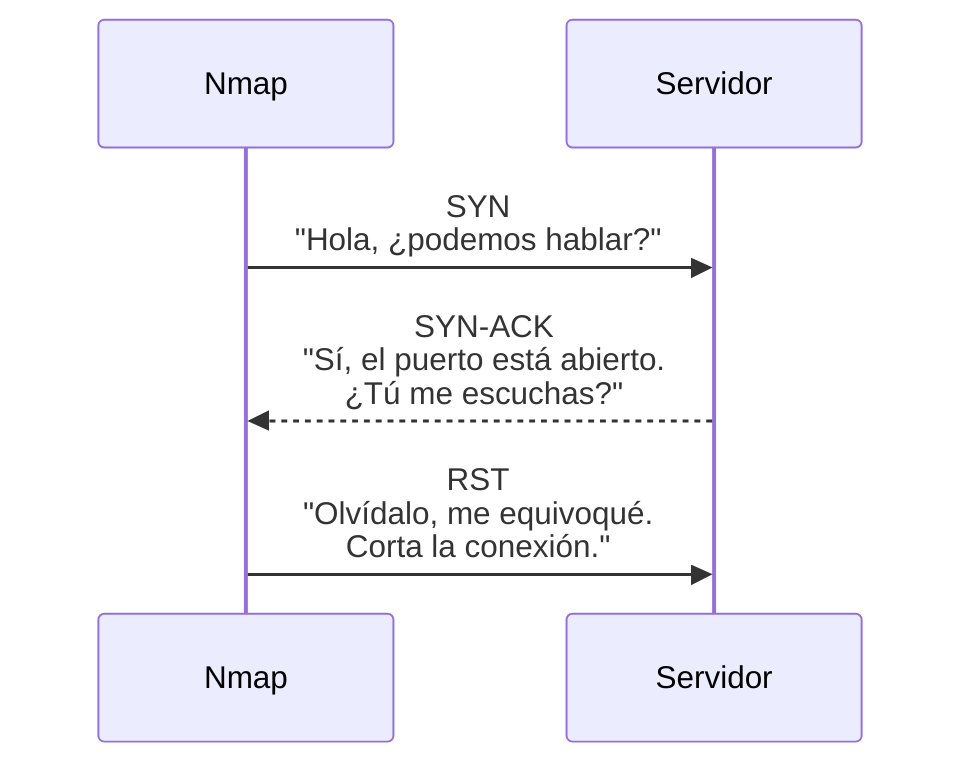

# Introduction to Nmap
Nos habla de que Nmap es una herramienta open source para el analisis y sirve como herramienta de auditoria que está escrita en C, C++, Python y Lua. Sinceramente está bastante bien Nmap, funciona para hosts o para enumerar una red completa. Podemos ver los servicios, detalles de los servicios utilizando los comandos adecuados. Obviamente tambien nos funciona para ver si los IDSs/IPSs estan bien configurados.
## Casos de Uso
Simple y sencillamente es una de las herramientas más utilizadas por gente del ambito tecnologico, usualmente es usada para:
- Auditar la seguridad respecto a la red
- Simular pruebas de penetración
- Verificar configuraciones de IDS/IPSs
- Mapeo de la red
- Identificar puertos abiertos
- Evaluación de vulnerabilidades
## Nmap Architecture
Obviamente nmap ofrece muchas funcionalidades y beneficios, las cuales son:
- Descubrimiento de hosts
- Escaneo de puertos
- Enumeración y detección
- Detección del OS
- Interacción con scripts
## Syntax
Para esto tengo una cheat sheet que puede ayudar a dar más información sobre lo que se puede hacer con nmap, la ruta es:
```bash
cd ~/Documents/Notes/Notes/HackTheBox/Knowledge/Cheat\ Sheets/
```
## Scan Techniques
Bueno, hay muchisimas maneras de realizar un escaneo pero debemos saber que hay 65535, pero estan en el protocolo TCP y UDP, por lo cual normalmente se realizan escaneos TCP, para evitar omitir información importante, debemos realizar el escaneo a ambos protocolos, ahorita se estan realizando a puro protocolo TCP, pero proximamente entrará el protocolo UDP.
En esta ocasión, se tratará sobre el uso de la tag ***-sS*** en el comando de Nmap, el cual se nos explicará más adelante lo que hace, aunque tengo entendido que es al hacer uso del protocolo TCP, se hace un seguimiento de la conexión en la cual pasa por varias fases. Es conocido como TCP Syn Three-Way Handshake. Donde el host manda un mensaje de sincronización conocido como SYN al servidor preguntando pues si es posible la conexión, el servidor manda un mensaje de vuelta llamado SYN-ACK, una vez que llega al host la respuesta del servidor, el host manda un ultimo mensaje conocido como ACK el cual confirma la conexión entre ambos.
Se vería algo parecido a:

Pero lo que hace Nmap es muyyy parecido, solo que juega con el ultimo paquete, en vez de utilizar ACK utiliza RST, el cual indica que el puerto está cerrado, se entiende? Es interesante, porque es como ir a tocar la puerta de alguien, salir corriendo, el abre la puerta confirmando que hay alguien, pero como corrimos a escondernos, pues no verá a nadie si abre la puerta. Bueno, conociendo lo que hace Nmap, podemos comprender que al no haber respuesta de conexión, el servidor nunca registrará quien está haciendo reconocimiento, por eso mismo es muy importante conocer los protocolos de comunicación.

