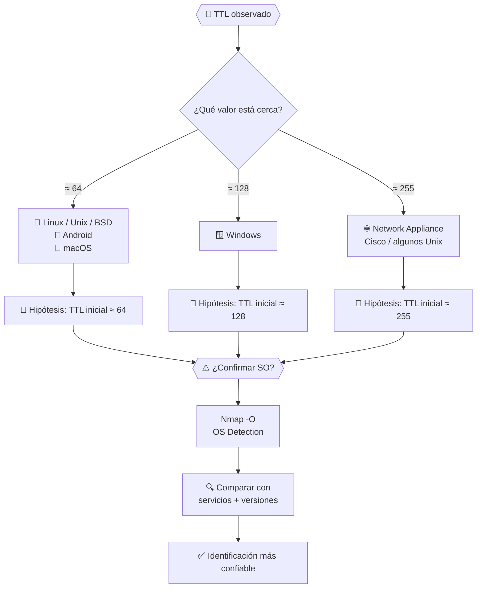

# Host Discovery
Okay, sinceramente estoy prolongando demasiado estos temas, nos habla de que podemos realizar un escaneo en un rango, una de las mejores formas es utilizar el protocolo ICMP para realizar el descubrimiento de más hosts en la red.
## Scan Network Range
Interesante, nos habla de un comando con el cual podemos realizar el escaneo mediante el protocolo ICMP, tambien habla de que eso es posible si el IDS/IPS/Firewall permiten esos protocolos en los hosts. Pero veremos como evadir esas herramientas cuando llegue el momento.
Uno de los comandos podría ser:
```bash
sudo nmap [IP]/[Submask] -sn -oA tnet | grep for | cut -d" " -f5
```

| **Scanning Options** | **Description**                                                  |
| -------------------- | ---------------------------------------------------------------- |
| `10.129.2.0/24`      | Target network range.                                            |
| `-sn`                | Disables port scanning.                                          |
| `-oA tnet`           | Stores the results in all formats starting with the name 'tnet'. |
Como he mencionado anteriormente, ese comando solamente funciona si no hay algún IDS/IPS/SIEM/Firewall detras, o que esté mal configurado, por eso mismo deberiamos buscar alternativas menos agresivas.
## Scan IP List
Interesante, en este apartado se nos habla de una lista de hosts que posiblemente nos dan o que sabemos que existe y queremos realizar enumeración o descubrimiento, entonces utilizaremos la lista, nmap permite pasar un archivo .lst con las IPs dentro a las cuales se quiere realizar el escaneo. Estos mismos aceptan una gran cantidad de parametros/flags/tags, por mencionar alguno común podría ser:
```bash
sudo nmap -sn -oA tnet -iL hosts.lst | grep for | cut -d" " -f5
```

|**Scanning Options**|**Description**|
|---|---|
|`-sn`|Disables port scanning.|
|`-oA tnet`|Stores the results in all formats starting with the name 'tnet'.|
|`-iL`|Performs defined scans against targets in provided 'hosts.lst' list.|
Como podemos observar, se puede realizar el escaneo a multiples IPs, esto da como resultado un ahorro de tiempo, aunque si quisieramos algo más especifico, creo yo que se recomienda ir de manera individual ajustando los parametros.
## Scan Multple IPs
A mi parecer es la misma cosa, que pasarle una lista, de hecho se me hace mejor practica utilizar una lista en vez de poner toda la lista en el comando.
* Ejemplo #1:
```bash
sudo nmap -sn -oA tnet 10.129.2.18 10.129.2.19 10.129.2.20| grep for | cut -d" " -f5
```
* Ejemplo #2:
```
sudo nmap -sn -oA tnet 10.129.2.18-20| grep for | cut -d" " -f5
```
Estos ejemplos que podemos ver son algunas de las funciones que tiene nmap, al final de cuentas estamos aprendiendo una herramienta, aunque se supone que debería ser tal cual el concepto de enumeración/descubrimiento, etc. Supongo que nos pone a utilizar nmap porque es de las más utilizadas.
## Scan Single IP
Y bueno, acá otro más, al final será un poco más de lo mismo, pero para solo una IP, el ejemplo que nos dan es la de obtener un poco más de información del host, que se puede almacenar la información en un archivo y luego analizarlo.
```bash
sudo nmap 10.129.2.18 -sn -oA host
```

|**Scanning Options**|**Description**|
|---|---|
|`10.129.2.18`|Performs defined scans against the target.|
|`-sn`|Disables port scanning.|
|`-oA host`|Stores the results in all formats starting with the name 'host'.


