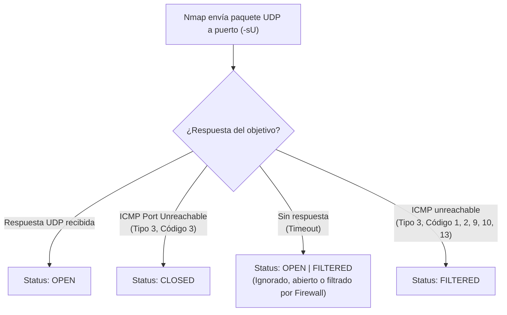

Conforme vamos avanzando nos damos cuenta de que nmap es bastante importante para obtener información, sigue siendo lo top de lo top. Claro que hay alternativas, pero nmap está muy bien pensada, por lo cual hay que comprender más que memorizar lo que hace cada tag de nmap, tal vez lo he repetido bastante, pero creo ciertamente en que es verdad.

Habla de los diferentes estados que nos puede arrojar nmap al realizar un escaneo, por lo cual debemos saber que significa cada uno y aprender a interpretar si hay alguna oportunidad o debemos continuar indagando.

|**State**|**Description**|
|---|---|
|`open`|This indicates that the connection to the scanned port has been established. These connections can be **TCP connections**, **UDP datagrams** as well as **SCTP associations**.|
|`closed`|When the port is shown as closed, the TCP protocol indicates that the packet we received back contains an `RST` flag. This scanning method can also be used to determine if our target is alive or not.|
|`filtered`|Nmap cannot correctly identify whether the scanned port is open or closed because either no response is returned from the target for the port or we get an error code from the target.|
|`unfiltered`|This state of a port only occurs during the **TCP-ACK** scan and means that the port is accessible, but it cannot be determined whether it is open or closed.|
|`open\|filtered`|If we do not get a response for a specific port, `Nmap` will set it to that state. This indicates that a firewall or packet filter may protect the port.|
|`closed\|filtered`|This state only occurs in the **IP ID idle** scans and indicates that it was impossible to determine if the scanned port is closed or filtered by a firewall.|
## Discovering Open TCP Ports
Antes de leer lo que dice HTB, puedo incluir que hay 65535 puertos TCP y otros 65535 puertos UDP, por lo cual usualmente es un poco lento el escaneo de nmap cuando se realiza un escaneo masivo o completo.
Indagando un poco en por qué es que alguien utilizaría algun metodo que deje una huella como podría ser un three way handshake completo y es porque utilizar la manera -Pn (creo que era ese) pues bombardea de manera constante el puerto y algún recurso sensible como una impresora suele saturar sus recursos, sin embargo si se completa el proceso de three way handshake este deja huella (log) pero no satura el servicio ni el dispositivo.
![[Pasted image 20260926222734.png]]
Creo que estoy confundiendo los tags -sS y -sT, según esto, -sS es el que pone por default nmap, y -sT es el que si hace el escaneo completo.
-sS es conocido como escaneo sigiloso o half-open, es utilizado cando se hace con privilegios root. y este es exclusivo de TCP.
-sT si hace la conexión TCP completo, este no requiere privilegios root, el cual será más lento ya que espera la respuesta del objetivo y este genera un log.

```mermaid
sequenceDiagram
    autonumber
    actor Attacker as Nmap (Attacker)
    participant Target as Target Host
    
    box rgb(35, 45, 60) TCP SYN Scan (-sS / Half-Open)
    Attacker->>Target: 1. SYN
    Target-->>Attacker: 2. SYN / ACK (Puerto Abierto)
    Attacker->>Target: 3. RST (Cancela conexión - Sin Log de aplicación)
    end
    
    box rgb(45, 55, 45) TCP Connect Scan (-sT / Full Handshake)
    Attacker->>Target: 1. SYN
    Target-->>Attacker: 2. SYN / ACK (Puerto Abierto)
    Attacker->>Target: 3. ACK (Conexión Establecida - Genera Log)
    Attacker->>Target: 4. RST / FIN (Cierra conexión)
    end
```
## El infierno de UDP (-sU)
Como bien sabemos, el protocolo UDP no espera confirmación, desecha paquetes si es necesario y no garantiza una entrega, por eso mismo se dice que es como gritar en una habitación y esperar que alguien responda.
![[Pasted image 20260926222615.png]]
1. Nmap envía un paquete UDP vacio a un puerto
2. Como UDP no garantiza la entrega el servicio no está obligado a responder
3. Nmap se queda esperando hasta que sale timeout
4. Como nmap no recibe nada, marca el puerto como *open|filtered*, nmap no sabe si el paquete llegó o si fue ignorado, o si un firewall lo bloqueó en el camino.
Por eso mismo, -sU tarda mucho, ya que se queda esperando por mucho tiempo.


![[Pasted image 20260926223025.png]]

![[Pasted image 20260926223033.png]]
Haré una prueba de nmap con ambos tags para comparar el tiempo y la información que arrojan.
1. -sS
```bash
sudo nmap -sS localhost
```
![[Pasted image 20260927112536.png]]
![[Pasted image 20260927113021.png]]
2. -sT
![[Pasted image 20260927113110.png]]
![[Pasted image 20260927113137.png]]

Como podemos observar, utilizar -sS o -sT no es significado  de que alguno vaya a ser más rápido que otro, sin embargo, usualmente -sS suele ser más veloz al no completar la conexión TCP. En este caso fue diferente, pero como muestra otra prueba, la conexión al puerto es menor que si se utiliza -sT.
## Scanning Top 10 TCP Ports
Ya que nmap hace el escaneo a los principales 1000 puertos este mismo nos proporciona una manera de elegir la cantidad de puertos del top de puertos puede escanear, se utiliza la flag *--top-ports=[cantidad]*.
Y el uso sería con el comando:
```bash
sudo nmap --top-ports=[cantidad] [IP]
```
![[Pasted image 20260927113314.png]]

| **Scanning Options** | **Description**                                                        |
| -------------------- | ---------------------------------------------------------------------- |
| localhost            | Scans the specified target.                                            |
| `--top-ports=10`     | Scans the specified top ports that have been defined as most frequent. |
## Nmap - Trace the Packets
Es un poco confuso porque ahora la explicación viene encima del subtema, pero habla de que si queremos información más clara del apartado de SYN podemos deshabilitar el protocolo ICMP *-Pn*, la resolución DNS *-n* y deshabilitar el escaneo ARP *--disable-arp-ping*
El comando completo sería:
```bash
sudo nmap -Pn -n --disable-arp-ping --packet-trace localhost
```
Este comando sinceramente me pareció más completo o raro, por lo cual creo que tocará investigarlo más adelante.
![[Pasted image 20260927120608.png]]
Un poco de más información:

| **Scanning Options** | **Description**                      |
| -------------------- | ------------------------------------ |
| `localhost`          | Scans the specified target.          |
| `-p 21`              | Scans only the specified port.       |
| `--packet-trace`     | Shows all packets sent and received. |
| `-n`                 | Disables DNS resolution.             |
| `--disable-arp-ping` | Disables ARP ping.                   |
Un poco de más información:
#### Request

| **Message**                                                 | **Description**                                                                                  |
| ----------------------------------------------------------- | ------------------------------------------------------------------------------------------------ |
| `SENT (0.0501s)`                                            | Indicates the SENT operation of Nmap, which sends a packet to the target.                        |
| `TCP`                                                       | Shows the protocol that is being used to interact with the target port.                          |
| `127.0.0.1:63090 >`                                         | Represents our IPv4 address and the source port, which will be used by Nmap to send the packets. |
| `127.0.0.1:21`                                              | Shows the target IPv4 address and the target port.                                               |
| `S`                                                         | SYN flag of the sent TCP packet.                                                                 |
| `ttl=46 id=49393 iplen=44 seq=2387990916 win=1024 mss 1460` | Additional TCP Header parameters.                                                                |
#### Response

| **Message**                                     | **Description**                                                                   |
| ----------------------------------------------- | --------------------------------------------------------------------------------- |
| `RCVD (0.0348s)`                                | Indicates a received packet from the target.                                      |
| `TCP`                                           | Shows the protocol that is being used.                                            |
| `127.0.0.1:21 >`                                | Represents targets IPv4 address and the source port, which will be used to reply. |
| `127.0.0.1:63090`                               | Shows our IPv4 address and the port that will be replied to.                      |
| `RA`                                            | RST and ACK flags of the sent TCP packet.                                         |
| `ttl=46 id=49393 iplen=44 seq=2387990916 win=0` | Additional TCP Header parameters.                                                 |
#### Connect Scan
Como sabemos, si queremos confirmar la conexión al puerto TCP se utiliza -sT, esto es completamente util si queremos estar 100% seguros del estado de un puerto.
Nos habla de que el escaneo -sT es de las menos discretas y actualmente cualquier IDS reconoce el comportamiento y lo bloquea, tambien es necesario recalcar que deja huella (logs) en el sistema escaneado y por ende este puede ser rastreado.
Actualmente los IDS/IPS más avanzados reconocen el comportamiento del metodo SYN, o -sS. Aunque este no realice la conexión completa.
#### Connect Scan on TCP 443
Es interesante, se habla del traqueo del puerto TCP 443 mediante el seguimiento de -sT, donde -Pn no da entrega mensajes ICMP en el cual se debe saber casi con seguridad que el puerto y el dispositivo está disponible, donde -n es el que deshabilita la resolución DNS y solo acepta IP, para el caso de --disable-arp-ping sinceramente no se que sea, pero según HTB ese tag deshabilita el ping ARP.
Comando:
```bash
sudo nmap -sT --disable-arp-ping -Pn -n -p443 
```
![[Pasted image 20260927200923.png]]
Como podemos ver, este realiza la conexión completa mientras que -sS no.
![[Pasted image 20260927201259.png]]
En esta imagen podemos ver la diferencia en tiempo y si se realiza un escaneo al sistema, podríamos ver la diferencia a nivel sistema, sin embargo, casi 100% seguro de que no genera un log.
## Discovering Open UDP Ports
Podemos utilizar la flag -sU para buscar por puertos UDP, y la flag -F para buscar entre el top 100 de los puertos.
```bash
sudo nmap -F -sU localhost
```

| **Scanning Options** | **Description**                                      |
| -------------------- | ---------------------------------------------------- |
| `localhost`          | Scans the specified target.                          |
| `-sU`                | Performs a UDP scan.                                 |
| `-Pn`                | Disables ICMP Echo requests.                         |
| `-n`                 | Disables DNS resolution.                             |
| `--disable-arp-ping` | Disables ARP ping.                                   |
| `--packet-trace`     | Shows all packets sent and received.                 |
| `-p 137`             | Scans only the specified port.                       |
| `--reason`           | Displays the reason a port is in a particular state. |
```bash
sudo nmap -Pn -sU -v -n --disable-arp-ping --packet-trace -p- --reason [IP]
```
![[Pasted image 20260927203238.png]]
Como podemos ver, la flag --packet-trace da muchisima información de los paquetes que se prueban,
#### Version Scan
Para escanear la versión podemos utilizar la flag -sV, obviamente este conlleva un escaneo más lento. Realmente no se si lo vuelve más escandaloso.
Podemos utilizar:
```bash
sudo nmap -Pn -n -sV --reason --disable-arp-ping --packet-trace -p- localhost
```

---
## Ejercicio
Bueno, para este apartado nos pedian que encontraramos cuantos puertos TCP estaban abiertos y el nombre del host, sinceramente me hubiese gustado que pidieran algo más especifico y más dificil, como lo hice fue muy eficiente, utilicé dos maneras, una con rustscan y otra con nmap, rustscan porque es más rápido y lo utilicé para que enlistara todos los puertos TCP, y nmap para que mostrara la versión de los servicios y con eso el nombre del host, aunque creo que hubiese sido lo mismo si tan solo utilizaba solo uno de los dos.
El comando que utilicé fue:
```bash
sudo nmap -Pn -n -v -sS -p- [IP]
```
Ya con eso saqué la cantidad de puertos TCP activos y el nombre de usuario.
