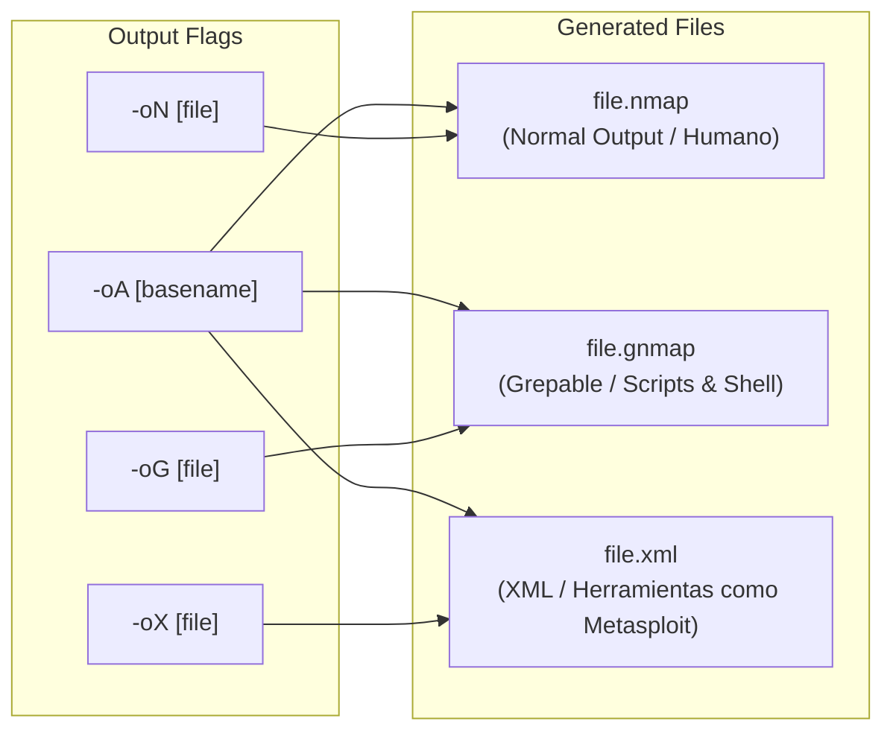

Sinceramente ya tengo una plataforma creada, pero de igual manera esta en una fase prematura.
Bueno, yo me hice una cheat sheet en la cual dice que hace cada cosa, en este caso nos da el tag -oA, el cual significa que guarda el resultado en todos los formatos; *.nmap, .gnmap, .xml*, son realmente utiles para hacer automatizaciones. Los diferentes tags son los siguientes (existen más):
- Normal output (`-oN`) with the `.nmap` file extension
- Grepable output (`-oG`) with the `.gnmap` file extension
- XML output (`-oX`) with the `.xml` file extension
En un comando se podría utilizar:
```bash
sudo nmap -p- -oA [nombre doc] [IP]
```
![[Pasted image 20260927224126.png]]
Como podemos ver, existen tres documentos llamado prueba, esos son los que da cuando se utiliza el tag -oA



| **Scanning Options** | **Description**                                                                 |
| -------------------- | ------------------------------------------------------------------------------- |
| `localhost`          | Scans the specified target.                                                     |
| `-p-`                | Scans all ports.                                                                |
| `-oA target`         | Saves the results in all formats, starting the name of each file with 'target'. |

---
## EJercicio
El ejercicio es sencillo, nos pide generar un documento y que agarremos el puerto con el numero más alto, para eso utilicé el comando:
```bash
sudo nmap -Pn -n -p- -oA Ejercicio --min-rate=5000 [IP]
```
Con eso obtuve el resultado que fue
> 35555