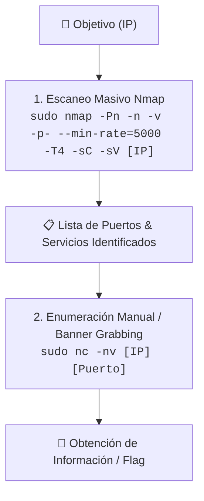

Sinceramente era muy sencillo, solo nos pedia enumerar todos los puertos y en algún servicio de ellos venía la flag, yo utilicé el comando:
```bash
sudo nmap -Pn -n -v -p- -sS/-sT --min-rate=5000 -T4 -sC -sV [IP]
```
Con eso logro que me de toda la información necesaria omitiendo cosas como el dominio, que esté vivo el nodo porque obviamente lo estaba, que escaneara todos los puertos utilizando syn/conexión completa con TCP, utilizando una velocidad de envio minima de paquetes de 5000, que me diera la versión y detalles de cada servicio.
Con eso obtuve una lista de puertos, luego simplemente utilicé nc para obtener más información:
```nc
sudo nc -nv [IP]
```
Con eso fui escaneando cada uno de los puertos y obteniendo información, en la cual en el puerto concreto obtuve la flag.



Y ya, se basó en algo que ya sabía, por lo cual no hubo ningún problema, aunque utilizando mi aplicación batallé, pero fue más error mio por no indagar en los puertos que ya tenia.