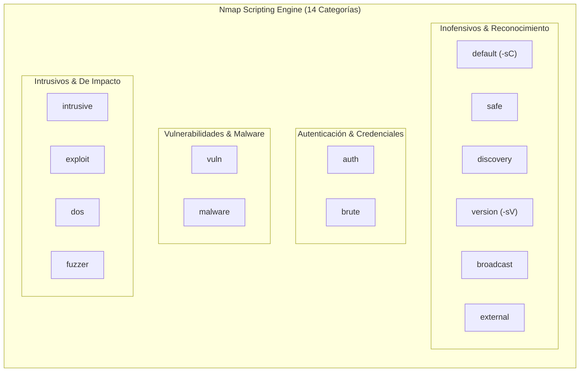
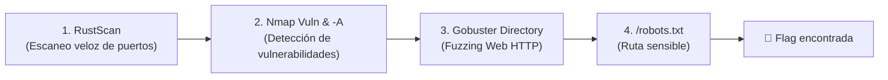

Esta vez estamos entrando a los NSE, sinceramente no tengo la menor idea de que es un NSE, pero de igual manera tocará indagar.
Dice que NSE nos da la herramienta para utilizar herramientas hechas en Lua para interactuar con ciertos servicios, dice que hay un total de 14 categorias las cuales se dividen en las siguientes:

| Categoría     | Explicación                                                                                                                                                                                                                                           | Ejemplo                                                                                                                                    |
| ------------- | ----------------------------------------------------------------------------------------------------------------------------------------------------------------------------------------------------------------------------------------------------- | ------------------------------------------------------------------------------------------------------------------------------------------ |
| **default**   | Scripts que se ejecutan automáticamente con `-sC`. Recogen banners, títulos HTTP, keys SSH, certificados SSL y accesos anónimos básicos. Rápidos, no destructivos y con poca generación de ruido. Si no especificas `--script`, nmap asume `default`. | `nmap -sV -sC -p 80,443 target` → Ejecuta `http-title`, `http-headers`, `ssl-cert`, `ssh-hostkey`, etc.                                    |
| **safe**      | Garantizan cero efecto negativo: no consumen recursos, no generan tráfico inusual, no modifican estado. Son estrictamente read-only. Subconjunto más amplio que `default` pero igualmente inofensivo.                                                 | `nmap --script safe -p 80,443 target` → Incluye `default` más `http-robots.txt`, `dns-service-discovery`, `ldap-rootdse`, etc.             |
| **discovery** | Enumeración profunda: subdominios, rutas de directorio, shares SMB, interfaces SNMP, usuarios, topología de red. Más lentos (múltiples peticiones) y pueden ser detectados por IDS. La categoría más usada en fase de enumeración.                    | `nmap --script "discovery and safe" -p 80,443,445 target` → `http-enum`, `smb-enum-shares`, `dns-brute`, `snmp-interfaces`, `ldap-search`. |
| **version**   | Solo se ejecutan bajo `-sV`. Extienden el fingerprinting con métodos HTTP, algoritmos SSH, puertos de proxy, etc. No corren si no usas `-sV`.                                                                                                         | `nmap -sV -p 80 target` → `http-methods`, `http-server-header`, `ssh2-enum-algos`.                                                         |
| **broadcast** | Envían paquetes broadcast/multicast para descubrir hosts no listados. Con `newtargets` los agregan al scan automáticamente. Requieren estar en la misma subred.                                                                                       | `nmap -sP --script broadcast-dhcp-discover --script-args newtargets 192.168.1.0/24`                                                        |
| **malware**   | Detectan si el target ya está comprometido: backdoors conocidos, daemons spoofing, puertos SMTP inusuales. Solo identifican patrones, no explota.                                                                                                     | `nmap --script malware -p- target` → `smtp-strangeport`, `auth-spoof`, `http-malware-domains`.                                             |
| **external**  | Consultan servicios de terceros: whois, geoip, bases CVE (Vulners, NVD), DNS blacklist. **Leak** que estás escaneando esa IP. Lentos por peticiones HTTP externas.                                                                                    | `nmap --script external -p 80 target` → `vulners`, `dns-blacklist`, `whois`.                                                               |
| **auth**      | Prueba credenciales por defecto, accesos anónimos o bypass de autenticación **sin** fuerza bruta. SNMP `public`, FTP anónimo, X11 sin password. No lanza diccionarios.                                                                                | `nmap --script auth -p 22,445,161 target` → `ftp-anon`, `snmp-interfaces`, `x11-access`.                                                   |
| **brute**     | Fuerza bruta real con wordlists contra SSH, FTP, HTTP, MySQL, RDP, etc. Genera muchos logs, puede bloquear cuentas (fail2ban) y es muy detectable. Último recurso.                                                                                    | `nmap --script ssh-brute --script-args userdb=users.txt,passdb=rockyou.txt -p 22 target`                                                   |
| **vuln**      | Checan CVEs y vulnerabilidades conocidas. Solo imprimen si **encuentran** algo. No explota: solo confirma. La categoría clave en vulnerability assessment.                                                                                            | `nmap --script vuln -p 443 target` → `ssl-heartbleed`. `nmap --script vuln -p 445 target` → `smb-vuln-ms17-010`.                           |
| **intrusive** | Pueden afectar negativamente: consumen ancho de banda, generan tráfico anómalo, causan timeouts o son detectados como ataque. No necesariamente tumban el servicio pero lo estresan. Solo en lab o con autorización explícita.                        | `nmap --script http-slowloris -p 80 target` → Agota el pool de conexiones del servidor.                                                    |
| **exploit**   | **Explotan activamente** la vulnerabilidad: ejecutan código, suben archivos, confirman RCE. La categoría más peligrosa. Puede dejar el sistema inestable. Solo en lab con autorización escrita.                                                       | `nmap --script http-fileupload-exploiter -p 80 target` → Sube un archivo para confirmar file upload.                                       |
| **dos**       | Pruebas de denegación de servicio: floods, paquetes malformados en volumen, exhaustan recursos. **Pueden dejar el target caído** hasta reinicio. Casi nunca se usa en pentests reales.                                                                | `nmap --script dos -p 80 target` → `http-slowloris`, floods UDP.                                                                           |
| **fuzzer**    | Envían datos malformados/aleatorios/extremos al servicio para encontrar crashes o bugs de parsing. Lento y disruptivo. Útil en lab para 0-days, casi inútil en pentesting real.                                                                       | `nmap --script http-form-fuzzer -p 80 target` → Envía valores extremos en cada campo de un formulario.                                     |



Hahaha, ahora entiendo el tag -sC, -sC son los scripts por default (nosé cuales son), en este caso podemos nosotros saltarnos ese -sC y utilizar los scripts que vienen ahí, sinceramente no sé porque no se agregó a la parte de mi app.
Al final por lo regular un tag es la combinación de varias acciones, usualmente se utilizan los tags porque se repite una acción, como ejemplo el de nmap *sudo nc -nv [IP] [Port]*
Sinceramente es super interesante, yo utilizaba los normales, -sC, -sS, -sV, sin saber que hay más combinaciones.

### Default Scripts
Para realizar el escaneo utilizando scripts por default, podemos utilizar;
```nmap
sudo nmap -v -sC [target]
```
Le dejaré el -v a todos para que vaya imprimiendo lo que va encontrando.
### Specific Scripts Category
Bueno, como hemos mirado arriba, podemos elegir cualquier script utilizando el tag *--script [category]*, quedaría:
```nmap
sudo nmap -v --script [script] [target]
```
### Defined Scripts
Este no lo comprendo bien, supongo que no ha de ser muy dificil. Okay, según lo que miré y recuerdo, es lo mismo que el anterior pero pasando más de un parametro a la parte de script, algún ejemplo sería:
```nmap
sudo nmap -v --scrip discovery,version [target]
```
### Nmap - Specifying Scripts
Sin embargo, podemos ir aún más a profundidad especificando lo que queremos que haga en un puerto. Un ejemplo sería;
```nmap
sudo nmap -v --script banner,smtp-commands -p 25 [target]
```
Creo que esto es un poco más complejo  ya que debemos conocer más a profundidad lo que hacen los scripts.

| **Scanning Options**            | **Description**                |
| ------------------------------- | ------------------------------ |
| `[Target]`                      | Scans the specified target.    |
| `-p 25`                         | Scans only the specified port. |
| `--script banner,smtp-commands` | Uses specified NSE scripts.    |
Como podemos observar, se le aplica a un puerto un script que se ejecuta, entonces el resultado es personalizado y a medida.
### Nmap - Aggresive Scan
Bueno, conozco la flag -A que es de aggresive, pero no se realmente bien lo que hace, supongo que ha de ser un conjunto de scripts que se ejecutan simultaneamente.
Uno de los comandos que se puede utilizar es:
```nmap
sudo nmap -v -p 80 -A [IP]
```
![[Pasted image 20260928175626.png]]
En la imagen podemos ver la diferencia de utilizar el tag aggresive y no utilizarlo.

| **Scanning Options** | **Description**                                                                                    |
| -------------------- | -------------------------------------------------------------------------------------------------- |
| `[target]`           | Scans the specified target.                                                                        |
| `-p [port]`          | Scans only the specified port.                                                                     |
| `-A`                 | Performs service detection, OS detection, traceroute and uses defaults scripts to scan the target. |
## Vulnerability Assessment
Como hemos observado, podemos utilizar --script vuln para ver si existe alguna vulnerabilidad conocida para un puerto, en htb nos dan el siguiente comando:
```nmap
sudo nmap -v -p 80 -sV --script vuln [IP]
```

| **Scanning Options** | **Description**                                        |
| -------------------- | ------------------------------------------------------ |
| `[target]`           | Scans the specified target.                            |
| `-p [port]`          | Scans only the specified port.                         |
| `-sV`                | Performs service version detection on specified ports. |
| `--script vuln`      | Uses all related scripts from specified category.      |

---
## Ejercicio
El chiste era buscar una vulnerabilidad, aunque la verdad habian un montón. El punto es que utilicé:
```nmap
sudo rustscan -a [IP]
```
Una vez que obtuve todos los puertos hice:
```nmap
sudo nmap -v -p [p1,p2,p3...] -sV -Pn -n --script vuln -A [IP]
```
Con eso obtuve mucha información de vulnerabilidades, primero me fui por el de HTTP, el cual despues utilicé:
```gobuster
sudo gobuster dir -u http://[IP] -w [Dirección/de/common.txt]
```
Y con eso obtuve información de algunas rutas, en la ruta */robots.txt* venia la flag.

