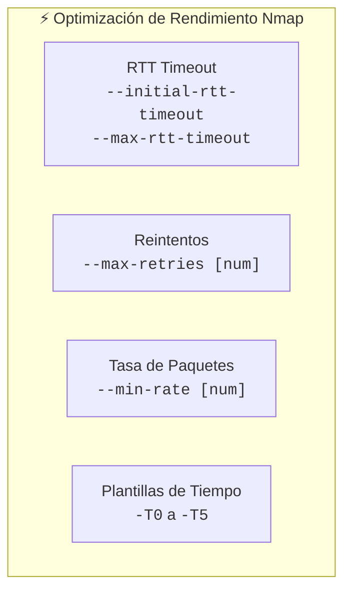
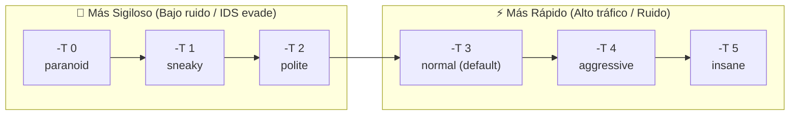

Sinceramente este capitulo viene bastante bien porque me ayuda a conocer de mejor manera las tags que se mirarán en este apartado.
## Performance
Nos habla de la importancia que tendrá si necesitamos escanear muchos nodos, o en todo caso, realizar un escaneo sigiloso. En este apartado nos dan tags en las cuales podemos realizar escaneos más agresivos o más sigilosos. 
Por ejemplo, nos dan el tag -T <0-5> el cual habla de que tan rapido se realizaría el escaneo, pero tambien indica que tan agresivo sería dicho escaneo, este se acompaña con --min--parallelism <[number]> el cual indicaría con que frecuencia se realizaría dicho escaneo. Hay muchisimas formas de hacer un escaneo, cantidad de paquetes enviados, cantidad de tiempo en espera, cantidad de reintentos, todo esto obviamente enlazado a los puertos que se desean escanear.


## Timeouts
Cuando Nmap envia un paquete, este toma algo de tiempo (Round-Trip-Time - RTT) para recibir una respuesta del puerto escaneado. Normalmente Nmap inicia un escaneo con alto tiempo de respuesta (--min-RTT- [timeout]) de 100ms. Nos muestran el siguiente ejemplo:
### Default Scan
```nmap
sudo nmap [IP] -F
```
Este resulta en un escaneo rapido.
### Optimized RTT
Es interesante, nos pone un round trip time minimo y uno maximo, esto con el fin de que sea un escaneo más controlado. Como por ejemplo:
```nmap
sudo nmap -F [IP] -F --initial-rtt-timeout [time] --max-rtt-timeout [timeout]
```

| **Scanning Options**         | **Description**                                       |
| ---------------------------- | ----------------------------------------------------- |
| `[IP]`                       | Scans the specified target network.                   |
| `-F`                         | Scans top 100 ports.                                  |
| `--initial-rtt-timeout 50ms` | Sets the specified time value as initial RTT timeout. |
| `--max-rtt-timeout 100ms`    | Sets the specified time value as maximum RTT timeout. |
## Max Retries
Interesante, nos habla de la cantidad de intentos en las cuales intenta recibir respuesta, por default son 10 intentos, se cambia con el siguiente comando --max-retries = [inttentos], si no recibe ninguna respuesta (en 0), este lo omitirá.
### Default Scan
Como podemos ver, el siguiente comando nos marca que hará el escaneo a los 100 principales puertos, filtrará por protocolo TCP.
```nmap
sudo nmap -F [IP] | grep "/tcp" | wc -l
```
### Reduced Retries
En este podemos ver como es que se ajusta a que no haga ningún intento si es que no encuentra respuesta al primer intento de escaneo.
```nmap
sudo nmap [IP] -F --max-retries 0 | grep "/tcp" | wc -l
```
## Rates
Bueno, todo depende del tipo de penetration testing, de la velocidad de internet y el modo en el que lo hacemos, pero podemos utilizar una velocidad minima en la cual se realiza el escaneo, utilizando la flag --min-rate [num].
### Default
Como se observará, este escaneo es un escaneo normal, haremos lo mismo pero quitando el archivo con formato, se realizará un escaneo normal basicamente.
```nmap
sudo nmap -F -oN [name] [IP]
```
### Optimized Scan
haha, okay, mirando un poco el comando, se puede apreciar que es simplemente agregarle cierta velocidad al envio de paquetes.
```nmap
sudo nmap -F -oN [name] --min-rate=[rate] [Domain/IP]
```

|**Scanning Options**|**Description**|
|---|---|
|`10.129.2.0/24`|Scans the specified target network.|
|`-F`|Scans top 100 ports.|
|`-oN tnet.minrate300`|Saves the results in normal formats, starting the specified file name.|
|`--min-rate 300`|Sets the minimum number of packets to be sent per second.|
### Default Scan - Found Open Ports
Okay, este es simplemente un grep al archivo que generó el comando anterior.
```cat
cat [file] | grep "/tcp" | wc -l
```
### Optimized Scan - Found Open Ports
A mi parecer es la misma cosa, al final de cuentas lo que andas buscando es un puerto con el protocolo TCP
```cat
cat [file] | grep "/tcp" | wc -l
```
## Timing
Este apartado es super importante, la verdad siempre olvido que valor tiene -T, por ejemplo, en gobuster -t le asigna valor a la cantidad de hilos que utilizará para realizar el escaneo.
El timing va desde 0 a 5, siendo 0 el más discreto, super util para evitar llamar la atención.
* -T 0  / -T paranoid
* -T 1 / -T sneaky
* -T 2 / -T polite
* -T 3 / -T normal
* -T 4 / -T aggresive
* -T 5 / -T insane
Hice la prueba poniendo el nombre y si funciona. Puede utilizarse alguna de las dos, empezaré a utilizar el nombre en vez del número.



