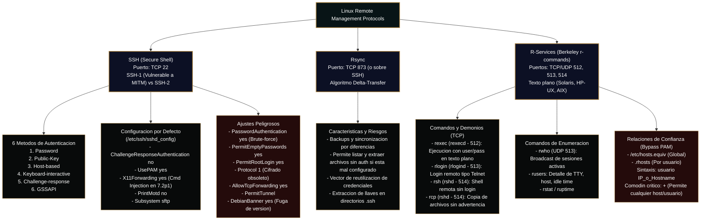
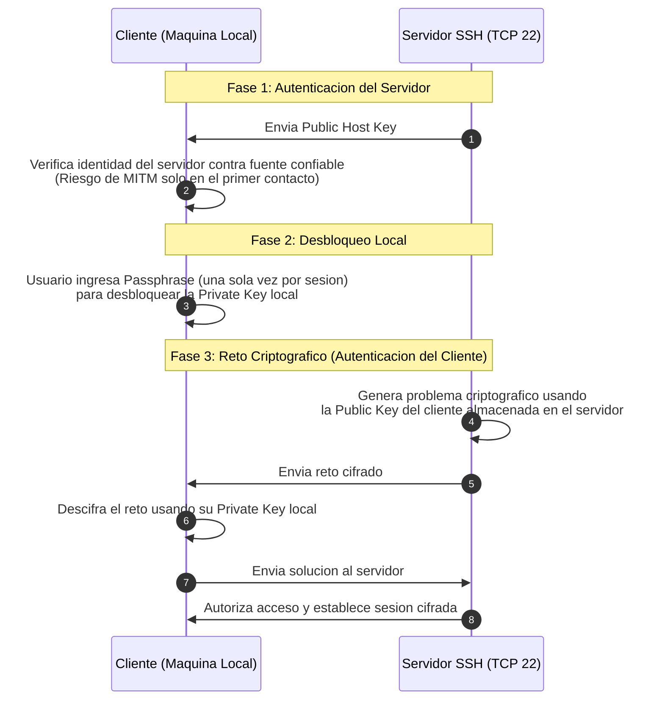
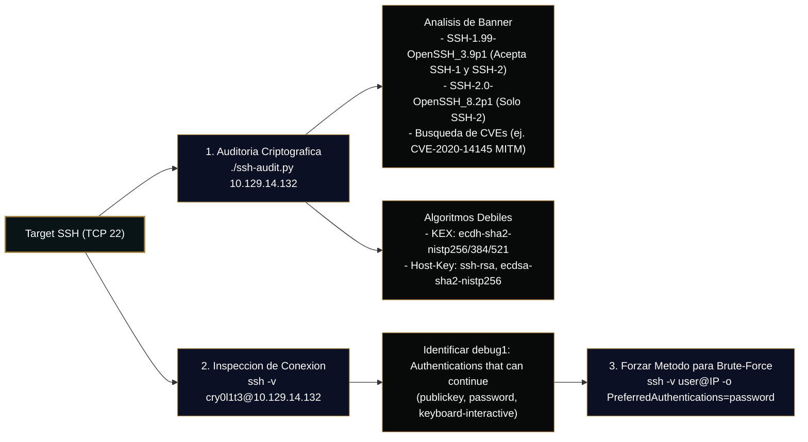

###### Arquitectura general, configuraciones y vectores de ataque

###### Secuencia de autenticación por llave pública en SSH


> [!NOTE] Nota: en el diagrama original, la "Fase 1" describe la verificación de la clave del host, y la "Fase 3" el reto criptográfico.
###### Flujo de Footprinting y enumeración en SSH

##### Playbook de enumeración y explotación: Rsync y R-Services

```mermaid
flowchart TD
    subgraph RSYNC_FLOW ["Flujo de Ataque Rsync (TCP 873)"]
        R_Scan["1. Escaneo Nmap<br/>sudo nmap -sV -p 873 127.0.0.1<br/>(Detecta protocolo version 31)"] --> R_NC["2. Probar Servicio y Listar Shares<br/>nc -nv 127.0.0.1 873<br/>Enviar comando: #list"]
        R_NC --> R_List["3. Enumerar Share Encontrado (ej. dev)<br/>rsync -av --list-only rsync://127.0.0.1/dev<br/>(Busca secrets.yaml, build.sh, carpeta .ssh)"]
        R_List --> R_Sync["4. Descargar Archivos al Host Atacante<br/>- Directo: rsync -av rsync://127.0.0.1/dev .<br/>- Sobre SSH: rsync -av -e ssh ...<br/>- Puerto custom: rsync -av -e 'ssh -p2222' ..."]
    end

    subgraph RSERV_FLOW ["Flujo de Ataque R-Services (TCP/UDP 512, 513, 514)"]
        RS_Scan["1. Escaneo de Puertos<br/>sudo nmap -sV -p 512,513,514 10.0.17.2<br/>(512 exec, 513 login, 514 tcpwrapped)"] --> RS_Audit["2. Abuso de Confianza (.rhosts / hosts.equiv)<br/>Ejemplo: htb-student 10.0.17.5 o comodin + +"]
        RS_Audit --> RS_Login["3. Acceso sin Credenciales<br/>rlogin 10.0.17.2 -l htb-student"]
        RS_Login --> RS_Post["4. Reconocimiento Interno de Red<br/>- Sesiones activas (UDP 513): rwho<br/>- Detalle extendido: rusers -al 10.0.17.5"]
    end

    style RSYNC_FLOW fill:#081416,stroke:#A98242,stroke-width:2px,color:#ffffff
    style RSERV_FLOW fill:#0C1024,stroke:#A98242,stroke-width:2px,color:#ffffff
    classDef box fill:#080A0A,stroke:#A98242,stroke-width:1px,color:#ffffff
    class R_Scan,R_NC,R_List,R_Sync,RS_Scan,RS_Audit,RS_Login,RS_Post box
```

Es curioso, habla de maneras para acceder a algún sistema remotamente pero solo habla de SSH, en fin.
Como sabemos, podemos acceder a un sistema de diferentes maneras, puede ser mediante el usuario y contraseña, utilizando la clave publica, entre otras maneras más avanzadas.
Pero en fin, siempre podemos aprender más sobre el protocolo Secure Shell, este da la posibilidad de establecer la conexión entre dos computadoras realizando la conexión directa de manera encriptada dentro de la red, esta red puede ser segura o no, se utiliza el protocolo TCP por el puerto 22. Como bien dice ahí, es necesario realizar la conexión cifrada utilizando el puerto 22 del protocolo TCP para que no haya una intercepción de los datos que viajan a través de la red. Una ventaja de SSH es que corre en todos los sistemas operativos comunes. Ya que es nativo de Linux este viene por default en distribuciones MacOS, tambien puede ser utilizando en Windows, pero ahí normalmente se utiliza otro servicio.
Todos conocemos OpenBSD SSH es un servicio SSH open source altamente utilizado en servidores.  Existen dos protocolos que compiten entre si: SSH-1 y SSH-1
Considerando que OpenBSD SSH es un fork del SSH original de paga.
SSH-2 también conocido como SSH versión 2, es un protocolo más avanzado que SSH versión 1 en cuanto a cifrado, velocidad, estabilidad y seguridad.
Por ejemplo SSH-1 es vulnerable a *MITM* attacks, mientras que SSH-2 no lo es.
Podemos imaginar que queremos administrar un host remoto. Se puede hacer mediante la linea de comandos o con GUI. 
Además, tambien podemos usar el protocolo SSH para enviar comandos al sistema, transferir archivos o configurar e lreenvio de puertos. Por lo tanto necesitamos conectanos a él mediante el protocolo SSH y autenticarnos. En total SSH cuenta con seis métodos de autenticación diferentes.
- Password authentication
- Public-key authentication
- Host-based authentication
- Keyboard authentication
- Challenge-response authentication
- GSSAPI authentication
De esos solo conozco al menos 3, pero los demás ni idea.
### Public Key Authentication
El primer paso el servidor SSH y el cliente se tienen que autenticar, el servidor envia su *Public Host Key* al cliente, entonces el cliente lo utiliza para verificar la identidad del servidor. Solo cuando el primer contacto está establecido hay un riesgo de que alguien intercepte la conexión. Una llave de host no puede ser imitada porque es un par de claves público-privada único, y un atacante no puede forzar la firma de la llave privada sin acceder a ella, siempre y cuando el cliente verifique correctamente la clave pública con una fuente confiable.
Despues de la autenticación, sin embargo, el cliente tambien deberá proveer al servidor que tambien tiene la autorización de acceso. Sin embargo, el servidor SSH ya dispone del valor hash cifrado de la contraseña establecida para el usuario deseado. Como resultado, los usuarios deben ingresar la contraseña cada vez que inician sesión en otro servidor durante la misma sesión. Por esta razón, una opción para la autenticación del lado del cliente es el uso de un par de claves pública y privada.
La llave privada es creada individualmente por el dueño de la computadora y se asegura con una frase que debería de ser más largo que una contraseña normal. La clave privada es almacenada exclusivamente en nuestra propia computadora y permanece siempre secreta. Si queremos establecer una conexión SSH, primero ingresamos la contraseña y de este modo obtenemos acceso a la clave privada.
Las llaves publicas tambien estan almacenadas en el servidor, el servidor crea un problema criptografico con la llave pubilca del cliente y la envia al cliente. El cliente desencripta el problema con su propia llave pricada, envia de vuelta la solución y  de este modo informa al servidor de que puede establacer una conexión legítima. Durante una sesión, los usuarios solo necesitan introducir la contraseña una vez para conectarse a cualquier número de servidores. Al finalizar la sesión, los usuarios cierran sesión en sus equipos locales, lo que garantiza que ningún tercero que obtenga acceso fisico al equipo local pueda conectarse al servidor.
## Default Configuration
el archivo de configuración *sshd_config* responsable del servidor OpenSSH tiene solo unas cuantas configuraciones configuradas por defecto. Sin embargo, la configuración por default incluye *X11 forwarding*, el cual contenía una vulnerabilidad de *command injection* en la versión 7.2p1 de OpenSSH en 2016. Sin embargo, no necesitamos una interfaz gráfica para administrar nuestros servidores.
### Default Configuration
![[Pasted image 20261108142630.png]]
La mayoría de los ajustes en este archivo de configuración están comentados y requieren configuración manual.
## Dangerous Settings
A pesar de que el protocolo SSH es una de los protocolos disponibles más seguros a día de hoy, algunas malas configuraciones pueden hacer el servidor SSH vulnerable para ejecutar ataques facilmente. 

|**Setting**|**Description**|
|---|---|
|`PasswordAuthentication yes`|Allows password-based authentication.|
|`PermitEmptyPasswords yes`|Allows the use of empty passwords.|
|`PermitRootLogin yes`|Allows to log in as the root user.|
|`Protocol 1`|Uses an outdated version of encryption.|
|`X11Forwarding yes`|Allows X11 forwarding for GUI applications.|
|`AllowTcpForwarding yes`|Allows forwarding of TCP ports.|
|`PermitTunnel`|Allows tunneling.|
|`DebianBanner yes`|Displays a specific banner when logging in.|
Permitir la autenticación mediante contraseña nos permite realizar un ataque de fuerza bruta a partir de un nombre de usuario conocido para encontrar posibles contraseñas. La neta HTB no tiene sentido que diga cosas cuando pues puede quitar mucho texto innecesario. 
Se suelen utilizar patrones especificos para modificar las contraseñas más comunes y sorprendentemente, corregirlas. Suponiendo que la contraseña sea segura, se utilizan los patrones mencionados para adivinar precisamente esos "ajustes"de las contraseñas. Sin embargo, existen instrucciones y guias de seguridad que pueden ayudar a reforzar la seguridad de nuestros servidores SSH.
## Footprinting The Service
Una de las herramientas que podemos utilizar es [ssh-audit](https://github.com/jtesta/ssh-audit). Verifica la configuración del cliente y del servidor, muestra información general y que algoritmo de encriptación son usados por el cliente y el servidor.
### SSH-Audit
![[Pasted image 20261108155538.png]]
La información que revela es importante, como podemos ver se ve la versión, que sistema operativo lo está utilizando, los algoritmos de encriptación, metodos de autenticación, entre otros.
### Change Authentication Method
![[Pasted image 20261108155924.png]]
Bueno, lo unico que ganamos con esto es ver los pasos que sigue la conexión, como podemos ver, nos muestra los metodos de autenticación, para realizar fuerza bruta podemos especificar el metodo para iniciar sesión. Se utiilza *PreferredAuthentications=[method]*
![[Pasted image 20261108160050.png]]
Para saber la versión podemos utilizar nc
```nc
nc [Target/IP] 22
```
## Rsync
Es una herramienta rápida para la copia remota o local de archivos. Puede ser utilizada para copiar archivos localmente en una maquina desde o para un host remoto. Es altamente versatil y muy conocida por su algoritmo de transferencia delta. Este algoritmo reduce la cantidad de datos transmitidos sobre la red cuando la versión de un archivo ya existe en el host, es el mismito que utiliza proxmox, por eso es que se me hacia conocido. En realidad si es bastante bueno y muy utilizado por su versatilidad. Esto lo hace solamente para enviar la diferencia de archivos entre la fuente y la versión antigua de los archivos que ya existian en el servidor. Normalmente es utilizado para backups y mirroring. Encuentra archivos que necesitan ser transferidos y mira los archivos que han tenido algún cambio de peso o han sido modificados. Por default utiliza el puerto 873 y configurandolo puede usar SSH para la transferencia segura de archivos, aprovechando una conexión de servidor SSH ya establecida.
### Scanning For Rsync
![[Pasted image 20261108162145.png]]
Con razón miré otro puerto abierto que no era el 22. Hablando del puerto 873 o del protocolo Rsync podemos realizar un escaneo con los scripts que ofrece nmap, ruta: <mark style="background: #ADCCFFA6;">*/usr/share/nmap/scripts*</mark>
#### Probing For Accessible Shares
Podemos examinar el servicio con más detalle para ver a qué podemos acceder, podemos utilizar netcat:
```nc
nc -nv [IP] 873
```
![[Pasted image 20261108170106.png]]
#### Enumerating An Open Share
Este es algo parecido a SMB, podemos observar que hemos encontrado un recurso compartido llamado *<mark style="background: #CACFD9A6;">dev</mark>* y podemos enumerarlo con el siguiente comando:
```
rsync -av --list-only rsync://[IP]/[Resource]
```
![[Pasted image 20261108170247.png]]
Como podemos ver en la salida de arriba, podemos sincronizarnos con los archivos que tiene dev, debemos tomar en cuenta que si Rsync está configurado para transferir archivos por SSH, podemos modificar la linea de comandos para que lo realice de esa manera, se debe agregar lo siguiente: *<mark style="background: #ADCCFFA6;">-e ssh</mark>* o *-e "<mark style="background: #ADCCFFA6;">ssh -p[puerto]</mark>*, recordando que el puerto de SSH puede ser modificado y puede estar utiilzando otro puerto.
## R-Services
R-Services son un conjunto de servicios alojados que permiten el acceso remoto o la emisión de comandos entre hosts Unix a través de TCP/IP. Inicialmente desarollado por *Computer Systems Research Group (CSRG)* en la universad de California